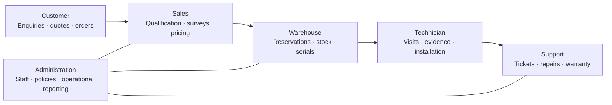
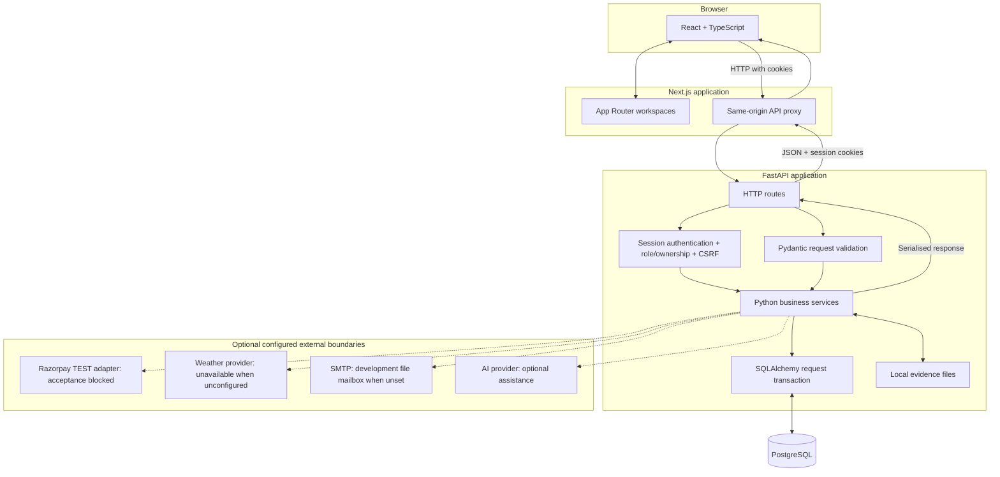

# SolarOps

*An end-to-end operating platform for rooftop solar installation businesses.*

SolarOps connects customer enquiries, sales, field teams and warehouse operations in one installation lifecycle. It carries survey evidence and versioned quotations through order fulfilment, serialised equipment, installation acknowledgment, warranty and after-sales service—so each team works from persisted business records.


[Run locally](#getting-started) · [Architecture](#system-architecture) · [Engineering](#engineering-highlights) · [Verification status](#verification-scope)

The source integrates six role workspaces around transactional business services. The verification section identifies the recorded database/browser checks and the external-provider acceptance required for a release.

[Engineering documentation](docs/README.md)

## Why SolarOps exists

A rooftop installation crosses several teams before the first panel generates power. Disconnected enquiries, survey notes and quotation revisions make sales handoffs difficult; inventory and installation schedules add another coordination problem. Warranty and support then need the original equipment and acceptance history.

SolarOps connects those records: an enquiry leads to a surveyed site, an accepted quotation funds an order, and fulfilment records identify the equipment that is delivered, installed and supported. Role-specific workspaces expose the next action while backend services enforce ownership and business transitions.

## Product preview

Six workspaces share the same API and PostgreSQL records:



The product map shows how the six workspaces share business records.

## Core capabilities

The following workflows have registered routes and implementation code; [verification scope](#verification-scope) records their acceptance evidence.

| Product area | Implemented workflow |
| --- | --- |
| Customer experience | Signup and email verification, session authentication, enquiries, quotation acceptance, order visibility, equipment coverage and support tickets. |
| Sales operations | Enquiry qualification, survey assignment/review, bill of materials and pricing, quotation revisions, payment records and order confirmation. |
| Field service | Calendar and assignments, survey measurements and uploads, installation evidence, arrival and customer acknowledgment guards. |
| Inventory and logistics | Component catalogue, reservations, stock receipts/transfers, picking, delivery, serial custody, replenishment and return/replacement operations. |
| Warranty and support | Equipment coverage and policies, complaint/repair workflows, service estimates and invoices, replacement tracking and customer acknowledgment. Paid extensions remain pending without verified settlement. |
| Administration and oversight | Employee provisioning, operational records, policy/configuration controls, finance reporting and audit events. |

Route inventory: [API router](apps/api/app/api/v1/router.py). UI access rules: [workspace roles](apps/web/src/lib/access.ts). API-level role and ownership checks remain authoritative.

## System architecture

A modular monolith: one Next.js application, one FastAPI application and PostgreSQL. Local evidence files are stored separately from database rows; back up both records and uploaded evidence.



The diagram shows responsibility boundaries, not a strict execution order for FastAPI dependencies. The [proxy](apps/web/src/app/api/%5B...path%5D/route.ts) forwards methods, bodies and cookies to the API. [Request sessions](apps/api/app/db/session.py) commit before success leaves the handler and roll back failures. There is no Redis, queue or independently deployed business microservice in this architecture.

Optional adapters are implemented source boundaries, not evidence of working external services. [Razorpay](apps/api/app/services/razorpay_service.py) accepts configured test credentials only and blocks live/production operation. Weather requires configured provider access and verified site coordinates; absent configuration returns an explicit unavailable state.

## Technology stack

The rationale below describes how each technology serves the implementation; it is not a performance benchmark.

| Technology | Role in SolarOps | Why it fits this implementation |
| --- | --- | --- |
| Next.js / React | App Router and role-specific interfaces | Shared UI components and a same-origin API boundary. |
| TypeScript | Frontend and generated API types | Makes request/response shapes visible during development. |
| FastAPI / Python | HTTP API and business services | Keeps workflow code together with generated OpenAPI. |
| Pydantic | Request and configuration schemas | Validates structured inputs at application boundaries. |
| SQLAlchemy | Models, queries and transactions | Expresses relational workflows and row locking in Python. |
| PostgreSQL | Business system of record | Foreign keys, uniqueness and transactional updates protect linked records. |
| Alembic | Versioned schema migrations | Reproduces schema changes without creating tables at app startup. |
| Argon2id | Password hashing | Explicit memory and time costs; passwords are not stored as plaintext. |
| pytest | Backend unit and PostgreSQL integration tests | Exercises service rules and real database transitions. |
| Playwright | Browser scenarios and axe integration | Checks role journeys, persistence and accessibility in a browser. |
| GitHub Actions | CI and pushgate workflows | Runs repeatable checks and retains gate evidence. |

Dependency manifests: [API](apps/api/pyproject.toml) · [web](apps/web/package.json).

## End-to-end business lifecycle

```mermaid
flowchart LR
    Signup[Customer registration] --> Enquiry[Customer enquiry]
    Enquiry --> Qualify[Sales qualification]
    Qualify --> Survey[Technician survey + sales review]
    Survey --> Quote[Versioned quotation + customer acceptance]
    Quote --> Payment{Payment verified?}
    Payment -->|No| Pending[Remain pending]
    Payment -->|Yes| Order[Sales order]
    Order --> Warehouse[Warehouse reservation + pick]
    Warehouse --> Delivery[Delivery + serial custody]
    Delivery --> Install[Installation evidence + customer acknowledgment]
    Install --> Warranty[Warranty lifecycle]
    Warranty --> Support[Support ticket + repair or replacement]
```



The arrows describe intended connected business transitions implemented by services, not a claim that one complete browser journey has passed. Records persist in PostgreSQL; quotation, order and stock transitions add audit events in their transaction. Delivery and installation have separate guards and coverage transitions—see [warehouse and installation design](docs/architecture/PHASE3_WAREHOUSE_INSTALLATION.md).

Development sandbox outcomes are simulations, **not provider settlements**. Recorded cash verification is a separate workflow. Neither proves Razorpay acceptance, a real charge, goods movement or a physical installation.

## Engineering highlights

- **Authorization beyond navigation.** Public signup assigns the customer role; the API resolves identity from a session and checks roles and record ownership. Hiding a workspace is not the enforcement boundary. See [dependencies](apps/api/app/api/deps.py) and [authentication service](apps/api/app/services/auth_service.py).
- **Password and session handling.** [Security primitives](apps/api/app/core/security.py) use Argon2id, random session tokens and keyed HMAC digests for stored tokens/OTPs. [Cookies](apps/api/app/api/cookies.py) and CSRF/origin checks support the same-origin proxy; production configuration must enable secure cookies and HTTPS. The in-memory request limiter is per process.
- **Transactional handoffs.** [Order confirmation](apps/api/app/services/order_service.py) locks enquiry/quotation state, checks accepted quotation and payment conditions, and creates downstream records inside the request transaction. A failed transition rolls back its related writes.
- **Retry and concurrency control.** Quotation, order and stock services use idempotency keys and reject conflicting reuse. [Inventory](apps/api/app/services/inventory_service.py) uses row locks around stock validation and allocation; [regressions](apps/api/tests) include competing picks and double-validation cases.
- **Quotation history and equipment identity.** [Quotation revisions](apps/api/app/services/quotation_service.py) retain versions and acceptance state. [Serial custody](apps/api/app/services/serial_custody.py) tracks individual units through warehouse and installation operations, supporting repair and replacement traceability.
- **Evidence-backed completion.** [Installation services](apps/api/app/services/installation_service.py) require evidence and customer confirmation rather than a free-form “done” flag. [Evidence storage](apps/api/app/services/evidence_store.py) validates stored uploads; lifecycle tests cover tampering and cross-job reuse.
- **Contracts and recovery are explicit.** CI regenerates [OpenAPI](contracts/generated/openapi.json) and TypeScript types and checks for drift. Alembic owns schema changes; [recovery guidance](docs/release/LOCAL_SETUP_AND_RECOVERY.md) calls for a protected dump and restoration into a separate database before upgrades. Recorded local rehearsals do not certify production recovery.

## Getting started

### Prerequisites

Python 3.12, [uv](https://docs.astral.sh/uv/), Node.js 22+, npm and PostgreSQL 15 or 16. The commands below target a POSIX shell and an existing local PostgreSQL server. [Windows/local PostgreSQL guidance](docs/qa/LOCAL_POSTGRESQL.md) is also available.

```sh
git clone https://github.com/akilanpl/-Solar-Installation-Management-System.git solarops
cd solarops
cp .env.example .env
```

Edit the ignored root `.env` before starting. Set `SOLAROPS_APP_ENV=development`, replace the example secret with a newly generated random value of at least 32 characters, and configure `SOLAROPS_DATABASE_URL` and `SOLAROPS_TEST_DATABASE_URL` for your own local database role. Use the `postgresql+psycopg` URL scheme. Do not reuse the checked-in example credentials or commit the completed file.

Keep the database names `solarops_dev` and `solarops_test` for this standard path. Configure trusted origins for `http://127.0.0.1:3000` and `http://localhost:3000`; local HTTP requires `SOLAROPS_COOKIE_SECURE=false`. Provider credentials are optional for startup; checkout remains unavailable without them.

### Initialise PostgreSQL

Using a local PostgreSQL administrator session, create a dedicated role with a password you choose interactively:

```sql
CREATE ROLE solarops LOGIN;
\password solarops
CREATE DATABASE solarops_dev OWNER solarops;
CREATE DATABASE solarops_test OWNER solarops;
```

`\password` is a `psql` command. Run this only for new databases; do not overwrite existing data. Match the role/password in your ignored `.env`. Docker users can inspect [Compose](docker-compose.yml), but must customise its example credentials and avoid competing with an existing server on port 5432.

### Migrate, seed and start

From the repository root:

```sh
cd apps/api
uv sync --frozen
uv run alembic upgrade head
uv run python scripts/seed_dev.py
uv run uvicorn app.main:app --host 127.0.0.1 --port 8000
```

In another terminal, from the repository root:

```sh
cd apps/web
npm ci
npm run dev
```

Open [SolarOps locally](http://127.0.0.1:3000). API [health](http://127.0.0.1:8000/api/v1/health), [database readiness](http://127.0.0.1:8000/api/v1/ready) and [interactive API docs](http://127.0.0.1:8000/docs) are separate endpoints.

The staff seed preserves existing accounts and generates a password in ignored `var/dev-seed-password.txt` when no seed password is configured. Staff use employee IDs such as `EMP-SALES-001`. Public customers register normally; without SMTP in development, verification messages go to ignored `var/dev-mailbox.jsonl`. The development mailbox route is backend-gated and unavailable in production.

For additional synthetic customer/enquiry fixtures, run `uv run python scripts/seed_demo.py` from `apps/api`. Its credentials stay in ignored `var/demo-credentials.json`. For isolated candidate databases and an optimised local preview, use the separate [setup and recovery runbook](docs/release/LOCAL_SETUP_AND_RECOVERY.md); its ports and database names differ from this guide.

### Run checks

**Database warning:** pytest drops and recreates the disposable test database's public schema. Never point tests at development, preview or business data. The standard allowed name is `solarops_test`; specially named release-test databases require an explicit matching disposable-name variable.

From the repository root, run the backend and frontend checks separately:

```sh
cd apps/api
uv run ruff check app tests scripts
uv run pytest
```

```sh
cd apps/web
npm test
npm run typecheck
npm run lint
npm run build
```

Contract checks, from the repository root:

```sh
make openapi
git diff --exit-code -- contracts/generated/openapi.json apps/web/src/generated/schema.ts
```

Browser scenarios use the local development stack and generated staff credentials. Seed demo fixtures first; from `apps/web`:

```sh
npx playwright install chromium
SOLAROPS_SEED_PASSWORD="$(tr -d '\n' < ../../var/dev-seed-password.txt)" npm run e2e
```

Some specialised scenarios additionally require their own seeded fixtures and configuration; running the entire suite with only the basic seed may not satisfy those prerequisites. The default Playwright configuration can start/reuse ports 3000/8000. Do not reuse a different preview or business database for these mutating scenarios. More specialised release scenarios have separate configurations in `apps/web`.

### Reset and recovery

Back up data and evidence before migrations. Restore backups into a new database and verify the result; do not use an unreviewed downgrade as a recovery shortcut. See [setup and recovery](docs/release/LOCAL_SETUP_AND_RECOVERY.md).

**Destructive development reset:** only when you intend to delete all `solarops_dev` data, run `uv run python scripts/reset_dev_db.py --yes` from `apps/api`. The script refuses other database names and non-development environments. This is not a startup step.

## Testing and quality assurance

| Layer | What the repository checks | Evidence / entry point |
| --- | --- | --- |
| Backend unit and integration | Pricing, workflow transitions, persistence, rollback and concurrent operations on disposable PostgreSQL | [pytest suite](apps/api/tests) |
| Frontend | Access routing, formatting and component/utility behavior | [Vitest configuration and scripts](apps/web/package.json) |
| API contracts | Generated OpenAPI and TypeScript schema drift | [CI](.github/workflows/ci.yml) |
| Authorization and security | Ownership, roles, CSRF, OTP replay/expiry, evidence tampering and payment guards | [Security report](docs/release/SECURITY_AND_RELIABILITY_REPORT.md), historical candidate evidence |
| Database and recovery | Empty migrations, model parity, preserved records and isolated restore rehearsals | [Migration audit](docs/release/COMPLETE_MIGRATION_AUDIT.md) and [recovery runbook](docs/release/LOCAL_SETUP_AND_RECOVERY.md) |
| Browser and accessibility | Playwright journeys, role checks and axe-based checks exist; full journey/compatibility acceptance is incomplete | [Browser report](docs/release/FULL_BROWSER_ACCEPTANCE.md), [multi-role report](docs/release/MULTI_ROLE_END_TO_END_REPORT.md) |
| Continuous integration | Backend lint/tests, frontend tests/types/lint/build and contract generation | [CI workflow](.github/workflows/ci.yml) |
| Release acceptance | Additional mandatory campaigns, coverage and evidence evaluation | [Pushgate workflow](.github/workflows/pushgate.yml), [runner](.pushgate/run.sh) |

Historical reports refer to different commits and sometimes retain superseded branch status. The [multi-role report](docs/release/MULTI_ROLE_END_TO_END_REPORT.md) records a later backend checkpoint than the older tracked gate JSON; neither certifies the current default-branch commit. Test totals and gate scores are deliberately not promoted to current badges or release claims here. Re-run checks and acceptance against the exact source under review.

The documentation review did not rerun application or provider acceptance. At the inspected `6bc512b` source, ordinary CI succeeded while the separate pushgate failed; these distinct outcomes must not be collapsed into a passing release claim.

## Repository structure

```text
apps/
  api/
    app/                  Routes, schemas, services, models and repositories
    alembic/              Versioned PostgreSQL migrations
    scripts/              Seed, contract, preview and recovery tooling
    tests/                Backend unit and database regressions
  web/
    src/app/              Next.js pages and same-origin API proxy
    src/lib/              Access rules and shared client utilities
    src/generated/        Generated API types
    e2e/                  Playwright scenarios
contracts/generated/      Implemented OpenAPI contract
contracts/planned/        Pointer to proposals, not live API guarantees
docs/                     Architecture, phase designs and release evidence
.github/workflows/        CI and pushgate
.pushgate/                Release gate runner and evaluation
```

## Verification scope

| Area | Current evidence boundary |
| --- | --- |
| Source integration | The inspected default branch includes Phase 1–4 source. Older reports saying “main is not merged” describe historical candidates. |
| Local demonstration | Development seeding, mailbox verification, role workspaces and recovery tooling are present. This documentation change does not constitute a fresh runtime verification. |
| Complete lifecycle | API/DB fixture journeys and selected role browser checks are recorded; a coherent complete customer-to-warranty browser acceptance remains unverified. |
| Payments | Development simulations are not settlements. Razorpay TEST adapter source exists, but credential-backed checkout/webhook acceptance remains blocked or unverified. Live/production provider operation is intentionally refused. |
| Warranty extensions | Requests exist; paid coverage must remain pending without extension-specific verified settlement. |
| Weather, AI and generation | Optional provider boundaries require configuration and provenance. Planning estimates are distinct from measured generation. No configured live provider or telemetry acceptance is claimed. |
| Passkeys and offline drafts | Implementation exists; real hardware/passkey and reconnect/conflict acceptance remain incomplete in release evidence. |
| Release and operations | Full accessibility/cross-browser, exact-commit release campaigns and operational acceptance are not established by the checked-in historical reports. No public deployment is verified. |

Read [release limitations](docs/release/FINAL_RELEASE_VERDICT.md) together with the [feature matrix](docs/release/PHASE1_TO_PHASE4_FEATURE_MATRIX.md) and current source. A merged source branch is not an accepted release.

## Project background

SolarOps began for the **Odoo x GCET Hyderabad Hackathon** and subsequently expanded through structured implementation, integration and verification work. Its portfolio focus is the connected business lifecycle and the engineering evidence behind it.

## Authors and project links

Git history records contributions under **Akilan / Akilan P L** and **VengadeshwararRao**. Adapted frontend source credits **ashwin-hue** in the [integration styles](apps/web/src/styles/integration.css) and teammate stylesheets. These credits preserve the repository's recorded attribution without assigning undocumented individual responsibilities.

[Repository](https://github.com/akilanpl/-Solar-Installation-Management-System) · [Contributors](https://github.com/akilanpl/-Solar-Installation-Management-System/graphs/contributors) · [Contributing](CONTRIBUTING.md) · [API contract](contracts/generated/openapi.json) · [Release documentation](docs/release/)

Documentation basis: [`6bc512b`](https://github.com/akilanpl/-Solar-Installation-Management-System/tree/6bc512bfb9f8ccc99dc3894ddb912ad32a3f640c). Recorded validation retains its original source and environment scope.
