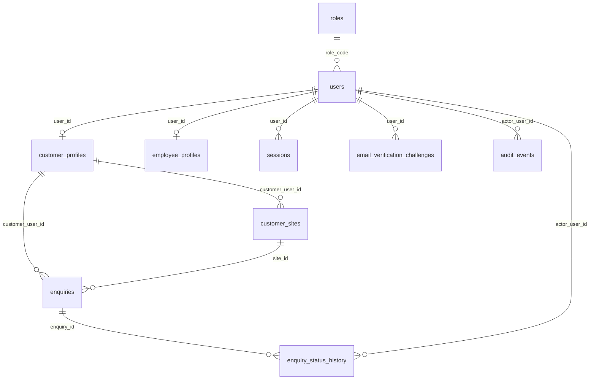

# Database design

PostgreSQL is the source of truth. Application code uses UTC (`SET TIME ZONE 'UTC'` on each connection in `app/db/session.py`). Money is integer paise in `enquiries.monthly_bill_minor`. Capacity is integer watts. Floating-point columns are not used for either.

The migration is `apps/api/alembic/versions/68d7cd857e38_phase_1_identity_enquiry_catalogue.py`. Applying it to an empty database creates the tables below and inserts roles plus the catalogue. It does not insert customers, enquiries, prices, or stock.

## Phase 1 tables

| Table | Purpose |
| --- | --- |
| `roles` | Allowed role codes. `is_staff` marks company roles. |
| `users` | Email, Argon2id password hash, role, verification time, active flag. |
| `customer_profiles` | Customer name and phone. Enquiry ownership points here. |
| `employee_profiles` | Employee ID, name, and phone. |
| `sessions` | HMAC of the session cookie, expiry, and revocation time. |
| `email_verification_challenges` | HMAC of the OTP, expiry, attempt count, consumed time. |
| `customer_sites` | Address captured with an enquiry. |
| `enquiries` | The connection request, idempotency key, and status. |
| `enquiry_counters` | Per-year reference counter, updated inside the enquiry transaction. |
| `enquiry_status_history` | From/to status, actor, and note. |
| `solar_packages` | Catalogue of on-grid and off-grid packages, the panel set, and installation. No list price. |
| `audit_events` | Append-only action log. The JSON body is column `metadata`. |

## Relationships

An enquiry cannot reference a staff user as its owner because `enquiries.customer_user_id` references `customer_profiles.user_id`, not `users.id` directly.

`UNIQUE (customer_user_id, idempotency_key)` stops a retried create from inserting a second row. Check constraints limit capacity to 1000–5000 watts in 1000 watt steps, bill amount, grid preference, and status.

Reference numbers come from `enquiry_counters` with `INSERT ... ON CONFLICT DO UPDATE ... RETURNING` in `enquiry_service._next_reference`. The counter update is in the same transaction as the enquiry, so a rolled-back insert does not consume a number. A PostgreSQL sequence would.

## Planned tables

These are not created. Adding empty tables would imply features that do not exist.

| Future area | Tables to add later | Invariants to preserve |
| --- | --- | --- |
| Survey | `surveys`, `survey_measurements` | Direction, tilt, and cable distance are measured values. A quotation cannot exist before survey approval. |
| Quotation and BOM | `quotations`, `quotation_revisions`, `bom_lines` | A revision is immutable. Acceptance creates one order. Prices are integer minor units. |
| Payment | `payment_intents`, `payment_events`, `invoices` | The provider id is stored. Status changes only from a verified provider event. No float money. |
| Order and delivery | `orders`, `deliveries` | Delivery confirmation is the event that may activate a warranty later. |
| Warehouse | `warehouses`, `locations`, `products`, `stock_ledger`, `stock_operations`, `serial_numbers`, `replenishment_requests` | See StockSense notes in `INTEGRATION_BOUNDARIES.md`. On-hand quantity is the sum of posted ledger rows, or a balance updated in the same transaction as the ledger insert. |
| Technician work | `jobs`, `job_assignments`, `arrival_challenges`, `work_evidence`, `signatures` | An assignment requires a skill match. Times are recorded, not invented. |
| Support | `tickets`, `ticket_events`, `warranty_decisions` | Warranty decision and charges are separate. Customer confirmation closes the ticket. |
| Costing | `cost_entries`, `technician_payables`, `subsidy_claims` | Profit is revenue minus posted costs. It is not a stored guess. |
| SysCache | no table in Phase 1 | The cache, when added, stores a version derived from source row timestamps. PostgreSQL remains authoritative. |
| Weather | `weather_readings` | `kind` is `observation` or `forecast`. The source and observed time are required. |

## Transactions

`get_db` is the boundary. `create_enquiry` and `qualify_enquiry` flush history and audit rows, then the dependency commits. An exception rolls the session back, so a failed qualification does not leave a history row without the status change, or the reverse.

The exception is a wrong OTP. `verify_email` commits the attempt count before raising, because a rollback would let the caller retry forever without burning the challenge. That commit is local to the failed attempt and is explained in `auth_service.verify_email`.
